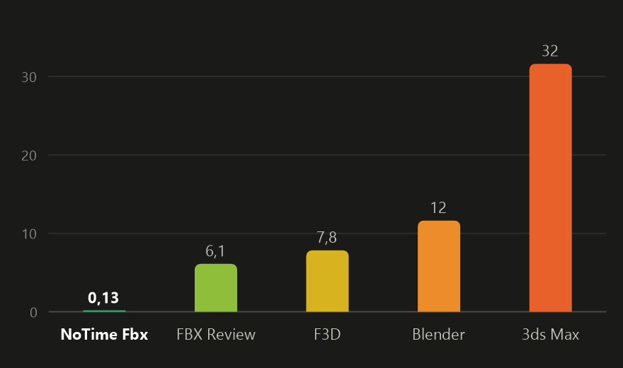
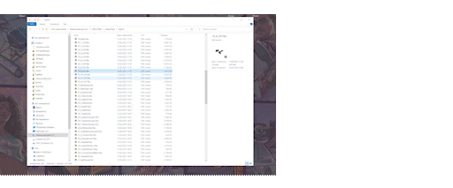

**English** | [Русский](README.ru.md)

# NoTime Fbx

A very fast FBX, STL and glTF viewer for Windows. Double-click an `.fbx`, `.stl` or `.glb` and the
model is on screen in about 10–20 ms. You can rotate, pan and zoom, and that's all it does.

> Powered by **WARP**. Yes, like the warp drive: while other programs crawl towards your model at
> sublight speed, NoTime Fbx simply bends space-time, and the model is already there.
> *(The boring truth: WARP is Microsoft's software Direct3D, which doesn't have to wait for the GPU driver.)*

## Speed

<table>
  <tr>
    <td width="50%"></td>
    <td width="50%" align="center"><br><sub><i>The only thing I can compare it to</i></sub></td>
  </tr>
</table>

Average time from launching the program to the model on screen, in seconds, over five models from
1k to 2.4M triangles (Windows 10, RTX 4060). FBX Review could not open the heaviest model, so its
average is over the other four.

## Install

Download `NoTimeFbx-setup.exe` from [Releases](../../releases) and run it. It installs for the
current user (no admin rights needed) into `%LOCALAPPDATA%\Programs\NoTimeFbx`, adds a Start menu
shortcut and offers to open `.fbx` files with it; for `.stl`, `.glb` and `.gltf`, pick it once via
right-click → Open with → NoTime Fbx. Uninstall from Settings → Apps.

**Portable:** download `NoTimeFbx-portable.exe` instead and just run it — nothing is installed.
Open a model by dropping it onto the window or with right-click → Open with.

## Controls

| Action | How |
|---|---|
| Rotate | left mouse button |
| Pan | middle or right mouse button |
| Zoom | mouse wheel, towards the cursor |
| Reset the view | F or double-click |
| Open another file | drop a model onto the window |
| Close | Esc |

## Under the hood

- **Fast start.** Light models (up to ~150k triangles) are drawn with WARP, Microsoft's software
  Direct3D 11, which is ready in ~5 ms instead of the ~140 ms it takes to load the GPU driver.
  Heavy models go straight to the GPU; if WARP can't keep up (big window, slow CPU), the model
  moves to the GPU on the fly.
- **Parallel loading.** The file is parsed ([ufbx](https://github.com/ufbx/ufbx),
  [cgltf](https://github.com/jkuhlmann/cgltf)) on all cores
  while the window and Direct3D are being created.
- **Cache.** FBX and STL models of 8 MB and up are stored ready to draw after the first open
  (`%LOCALAPPDATA%\NoTimeFbx\cache`, at most 2 GB), so reopening them skips parsing. glTF isn't
  cached: it already loads about as fast as a cache entry.
- **Textures** stream in after the first frame: PNG, JPEG, TIFF, BMP, DDS, TGA; cut-outs (foliage,
  fences) are detected automatically.
- Binary and ASCII FBX, including files from "kn5 converter" (Assetto Corsa).
- Binary and ASCII STL: flat facet normals, one gray material; Z-up files are stood upright to
  match the viewer's Y-up.
- glTF 2.0: `.glb` and `.gltf` (external or embedded buffers and images), base color and its
  texture, cut-outs (alpha mask). Animation and skinning are ignored (bind pose);
  Draco/meshopt-compressed geometry and KTX2 textures are not supported.

## Building

You need MSVC (Visual Studio 2022 or newer with "Desktop development with C++") and Windows SDK
10.0.22621 or newer. Then:

```
build.bat          :: release: build\NoTimeFbx.exe and build\NoTimeFbx-setup.exe
build.bat debug    :: debug build
```

The icon is built from `icon.png`: `powershell -ExecutionPolicy Bypass -File res\make_icon.ps1`.

### Diagnostic environment variables

| Variable | Effect |
|---|---|
| `NOTIMEFBX_TIMING=1` | startup timings per stage in the window title |
| `NOTIMEFBX_LOG=1` | log to `%TEMP%\NoTimeFbx.log` (materials, textures, renderer choice) |
| `NOTIMEFBX_NOCACHE=1` | don't use the cache |
| `NOTIMEFBX_RENDERER=gpu\|warp` | force the renderer |
| `NOTIMEFBX_WARP_MAX_TRIS=N` | triangle threshold for WARP (default 150000) |

## License

MIT, see [LICENSE](LICENSE). The bundled [ufbx](https://github.com/ufbx/ufbx) library keeps its own
license (MIT / Public Domain, `third_party/ufbx/LICENSE`), with a small change described in
`third_party/ufbx/PATCHES.txt`. The bundled [cgltf](https://github.com/jkuhlmann/cgltf) v1.15 is
MIT (`third_party/cgltf/LICENSE`).
